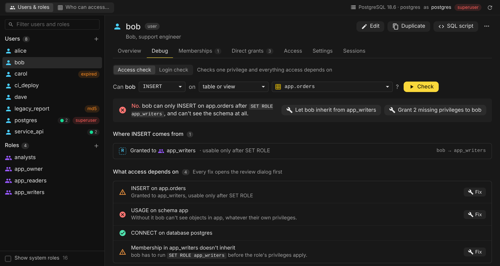
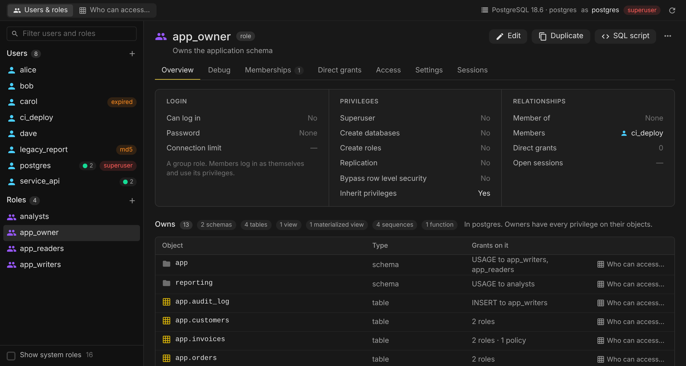
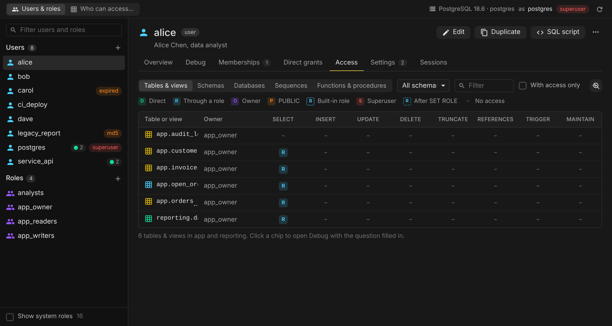
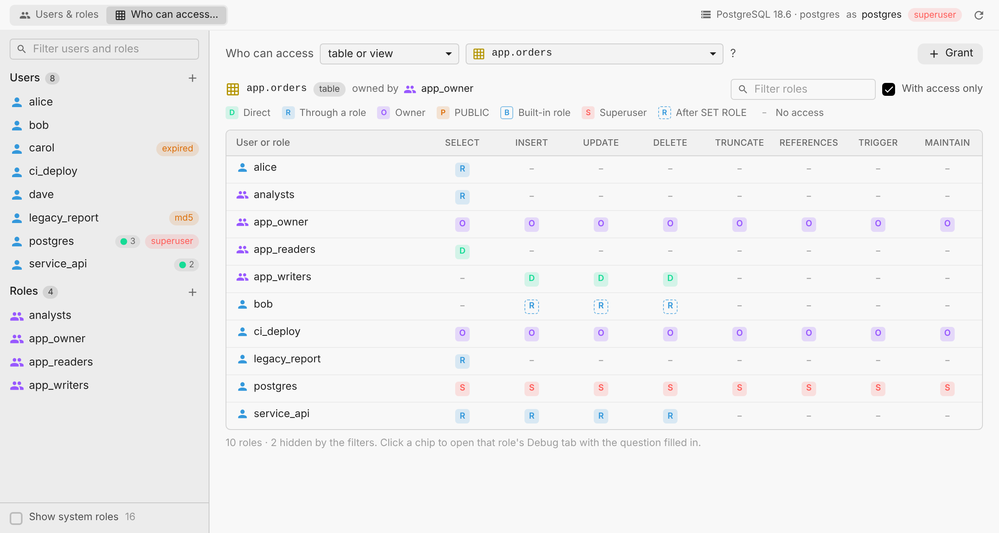
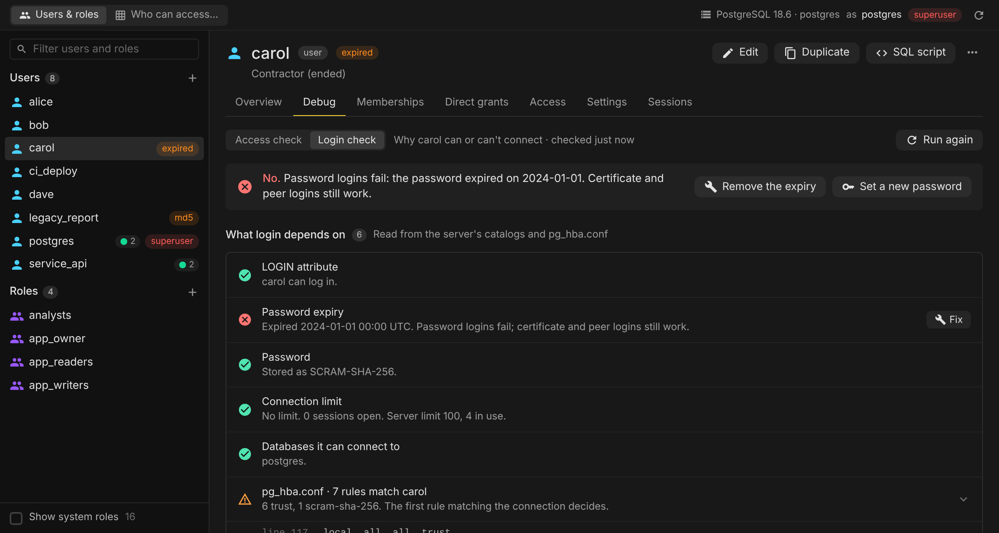
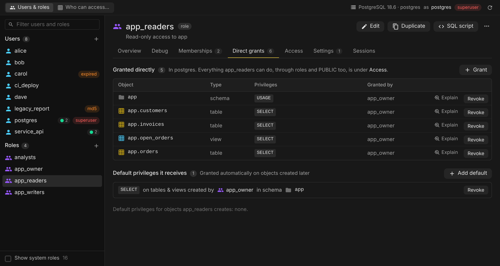
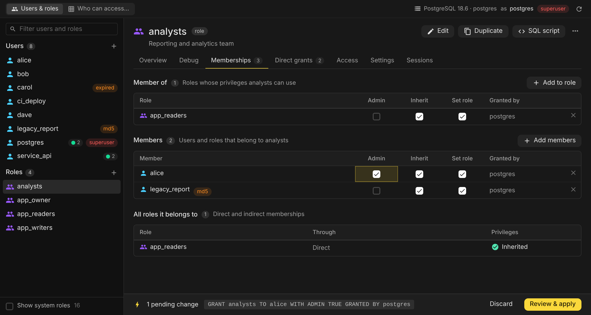
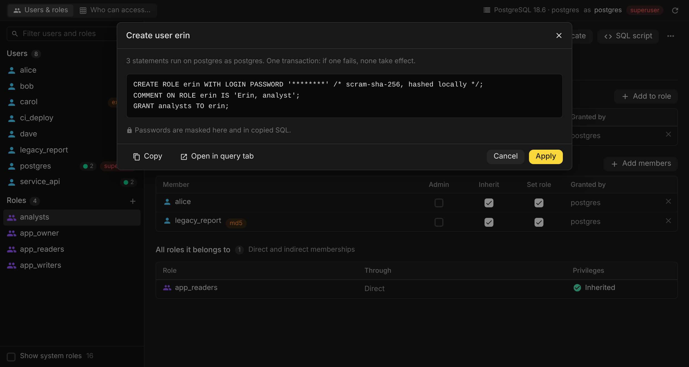

# User Management

A [Beekeeper Studio](https://www.beekeeperstudio.io) plugin to view, create,
edit and delete database users and roles, manage their privileges, and find
out why someone can or can't access something.



- **Users and roles:** every attribute (LOGIN, SUPERUSER, CREATEROLE,
  connection limit, password expiry...), comments, open sessions, and badges
  for expired, MD5 and superuser accounts.
- **Create, edit, rename, duplicate and drop**, with passwords hashed in the
  plugin so the plain text never reaches the server or its logs.
- **Memberships** in both directions, with PostgreSQL 16's ADMIN, INHERIT and
  SET options, and every role a user belongs to indirectly. Ticking an option
  queues it as a pending change, like a cell edit in a table tab.
- **Direct grants** on any object, on everything in a schema, and default
  privileges for objects created later.
- **Access:** a grid of what a role can actually do, with a letter for where
  each privilege comes from.
- **Who can access this?** Every role's privileges on one table, view, schema,
  sequence, function or database.
- **Debug:** "Can bob INSERT on app.orders?" answered with the reason, every
  other check access depends on (schema USAGE, CONNECT, row level security,
  column grants, non-inherited memberships), and one-click fixes.
- **Login check:** LOGIN, expiry, password type, connection limits, CONNECT
  privileges and the pg_hba.conf rules that apply.
- **Settings and sessions:** per-role parameters (`ALTER ROLE ... SET`) and open
  connections, which can be terminated.

Every change is shown as SQL for review before it runs, and can be copied or
opened in a query tab instead.

## Supported databases

| Database   | Users & roles | Grants & defaults | Access & debugging | Login check |
| ---------- | ------------- | ----------------- | ------------------ | ----------- |
| PostgreSQL | Yes           | Yes               | Yes                | Yes         |
| MySQL      | Planned       |                   |                    |             |
| SQL Server | Planned       |                   |                    |             |

Tested with PostgreSQL 12, 16 and 18. The plugin is built around a
database-neutral model, so each database only needs an adapter (see
[Adding a database](#adding-a-database)).

## Using it

- **Tools → Users & Roles**, or **Users & Roles** in the new tab menu.
- Right-click a table or schema in the sidebar and choose
  **Who Can Access This?**

The tab opens on the role you are connected as. Pick a user or role on the left
to see its details. The **Overview** shows its attributes, memberships and
everything it owns, with who else has privileges on each object.



### Access

What a role can do on every table, schema, database, sequence or function. Each
privilege is a letter for where it comes from: **D** granted directly, **R**
through a role it belongs to, **O** owner, **P** PUBLIC, **B** a built-in role
such as `pg_read_all_data`, **S** superuser. A dashed letter means the privilege
is only available after `SET ROLE`, and a dash means no access. Click a letter
to open Debug with the question filled in.



Whether a role holds a privilege always comes from PostgreSQL's own
`has_table_privilege()` family of functions, so the answer is never a guess. The
plugin then works out the reason from the object's ACL and the membership graph.

### Who can access this?



Also opened from **Who can access…** on any object in a role's Overview.

### Debug

The **Access check** reads as a question: "Can bob INSERT on table or view
app.orders?" The answer says where the privilege comes from and, besides the
privilege itself, checks everything else access depends on:

- `USAGE` on the schema and `CONNECT` on the database
- memberships without `INHERIT`, where the privilege only works after `SET ROLE`
- row level security: whether policies apply to the role, or hide every row
- column grants, when only some columns are allowed

Each failing check offers the statements that fix it, which open for review.
The **Explain** button in Direct grants and the letters in Access open the same
check.

The **Login check** explains why a user can or can't connect, with the
matching `pg_hba.conf` rules grouped under one row:



Reading password state and `pg_hba.conf` rules needs a superuser. Other checks
work for any role.

### Direct grants and default privileges



**Grant** gives privileges on one object (optionally just some columns), on
everything in a schema, or on objects created later (default privileges). The
"everything in a schema" option can add the default privileges in the same
change, so new tables don't get missed.

### Memberships



Ticking ADMIN, INHERIT or SET queues the change. The bar at the bottom shows
the pending statements, and **Review & apply** sends them all to one review.
Switching to another user or role asks before discarding them.

### Reviewing changes



All the statements of a change are sent as one request, which PostgreSQL runs as
a single transaction: if one fails, none of them take effect.

Passwords are hashed in the plugin with SCRAM-SHA-256 (or MD5, when the server's
`password_encryption` is `md5`), the way psql's `\password` does. The plain text
never reaches the server, so it can't show up in server logs or
`pg_stat_statements`. Passwords with non-ASCII characters are sent as plain text
for the server to normalize, with a warning.

**Drop** checks what depends on the role first: objects it owns, privileges, and
objects in other databases, which must be cleaned up there. It can reassign
owned objects to another role, drop what's left and terminate open sessions.

On a read-only connection everything can be browsed, and changes can be
reviewed and copied, but not applied.

## Development

Requires Node.js 22+ and Yarn 1.

```bash
yarn install
yarn dev        # builds with hot reload and links the plugin into Beekeeper Studio
yarn test       # unit tests, plus integration tests when PG_URL is set
yarn build      # type-check and build into dist/
```

`yarn dev` uses [`@beekeeperstudio/vite-plugin`](https://www.npmjs.com/package/@beekeeperstudio/vite-plugin),
which symlinks this folder into Beekeeper Studio's plugin directory.

By default Beekeeper Studio only loads its own allow-listed plugins. To load
this one, add the following to your
[user configuration file](https://docs.beekeeperstudio.io/user_guide/configuration/)
and restart the app:

```ini
[pluginSystem]
disabled = false
```

### Harness

`dev/harness.html` stands in for Beekeeper Studio: it loads the plugin in an
iframe and answers its requests with the same messages the app uses, running
queries against a real PostgreSQL server. It's the quickest way to work on the
UI, try every way the tab can be opened, switch themes and try read-only mode.

```bash
docker run -d --name pg -e POSTGRES_PASSWORD=pw -p 5432:5432 postgres:18
psql postgres://postgres:pw@localhost:5432/postgres -f scripts/fixtures/seed.sql
PG_URL=postgres://postgres:pw@localhost:5432/postgres yarn harness
```

The seed creates demo users and roles (alice, bob, carol, app_readers...) with
the kinds of problems the Debug tab finds.

### Tests

- `tests/postgres` covers SQL generation and quoting, and how privileges are
  explained.
- `tests/core` covers password hashing (checked against Node's crypto), the
  membership graph and timestamps.
- `tests/state` covers the tab's behaviour with a fake host and engine.
- `tests/integration` runs every read and change against a live server in a
  scratch database: creating users whose hashed passwords really log in,
  memberships, grants, default privileges, access checks and their fixes, row
  level security, login checks, settings, sessions and drops. It runs when
  `PG_URL` is set and is skipped otherwise. CI runs it on PostgreSQL 12, 16 and
  18.

## How it works

```
src/
  core/        database-neutral helpers: membership graph, formatting, hashing
  engines/     the shared model (types.ts), the registry, one adapter per database
    postgres/  catalog queries, SQL generation, privilege explanations, diagnostics
  host/        everything that talks to Beekeeper Studio
  state/       the tab's state and actions
  components/  Vue components: the list, the detail tabs, dialogs
```

The UI only knows the types in `src/engines/types.ts`:

- **Principals** (users, roles, logins...) with a `kind` and a map of
  attributes. The engine describes each attribute (`AttributeDef`: type, group,
  which kinds it applies to, whether it's dangerous), so the create and edit
  forms are generated, not written per database.
- **Memberships** with engine-defined options (`MembershipOptionDef`).
- **Object types** with their privileges and what they support: everything in
  a schema, default privileges, column privileges.
- **Privilege cells**: allowed or not, plus the sources that explain it.
- **Checks** with a status, a detail and an optional fix.
- **Change plans**: statements (with a masked display version for secrets) and
  warnings. The UI shows a plan for review and then hands it back to the engine
  to run.

`Capabilities` tells the UI which tabs and options to show for a database.

### Adding a database

1. Create `src/engines/<name>/` with an object implementing
   `UserManagementEngine` (`src/engines/types.ts`):
   - `capabilities(server)`: kinds, attributes, membership options, object types.
   - `listPrincipals`, `listMemberships`, `loadDetail`, `listObjects`: read the
     catalog.
   - `plan*`: build statements without touching the database, so they can be
     unit tested. `execute` runs a reviewed plan.
   - `effectivePrivileges`, `objectAccess`, `checkAccess`, `diagnoseLogin`,
     `dropInfo`: the debugging views. Use the database's own privilege checks
     for the answer wherever it has them.
2. Register it in `src/engines/registry.ts`.
3. Add unit tests for the SQL and an integration test against a real server,
   like the PostgreSQL ones.

Notes for the planned databases:

- **MySQL / MariaDB:** accounts are `'user'@'host'` (the host is part of the
  principal's id), roles exist from MySQL 8.0 and MariaDB 10.0.5, and
  `SHOW GRANTS FOR` plus `information_schema.*_privileges` give the grants.
  There are no default privileges or ownership. Beekeeper Studio's MySQL
  connection may not run several statements in one request, so `execute` may
  need to run them one at a time (`atomic: false`), and DDL commits implicitly.
  Hashing passwords in the plugin (`IDENTIFIED WITH ... AS`) means producing
  each authentication plugin's own hash format.
- **SQL Server:** two levels, server logins and database users, map to two
  kinds. Fixed and custom roles exist at both levels. `fn_my_permissions` and
  `HAS_PERMS_BY_NAME` answer access questions, but only for the current login
  (or with `EXECUTE AS`, which needs IMPERSONATE).
- **Oracle:** users and roles, system privileges as attributes, and
  `DBA_SYS_PRIVS` / `DBA_TAB_PRIVS` / `DBA_ROLE_PRIVS` for grants.

## Releasing

1. Run `bin/make-release.sh`. It suggests the next version from the existing
   tags, sets `version` in `manifest.json` and `package.json`, commits, and
   pushes a matching tag such as `v0.1.0`.
2. The release workflow builds, tests and creates a draft GitHub release with
   `manifest.json` and `user-management-<version>.zip`. Publish the draft.

`yarn build && yarn package` creates the same archive locally.

## License

GPL-3.0. See [LICENSE](LICENSE).
